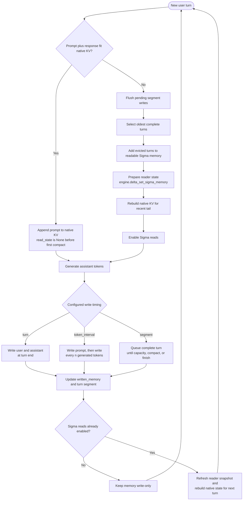
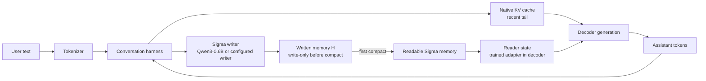

# sima-mem-harness

A minimal multi-turn conversation harness for the following Sigma-memory
protocol: **use only the model's native KV cache before compaction, and enable
Sigma-memory reads only after compaction**.

This repository provides conversation orchestration. It does not replace the
DeepSeek-V4.1 training or serving backend. It follows the Sigma-memory design
used by the project: the writer produces an additive second-moment statistic
`H`, compacted history is moved into readable memory, and the backend converts
that memory into the model's per-layer read state.

## Protocol

User/assistant history is written to Sigma memory according to the configured
write schedule:

```text
turn -> writer -> written_memory
```

Before the first compact, `written_memory` is write-only. Every backend call
receives `read_state=None`:

```text
recent conversation -> native KV -> model
history             -> Sigma writer only
```

When a new prompt plus its expected response would exceed the native context
window, the harness:

1. Evicts the oldest complete conversation turns while retaining a recent
   token tail.
2. Adds the evicted turns to `readable_memory`.
3. Rebuilds the native KV cache for the retained tail.
4. Starts passing `read_state` to the backend, enabling Sigma-memory reads.

Turns completed after compaction are also written to Sigma memory and become
readable on the next turn. `written_memory` and `readable_memory` are kept
separate so recent turns still present in native KV are not read twice.

The session state now keeps complete-turn `MemorySegment` objects, a
`memory_version`, and an immutable `ReaderSnapshot`. Reader states are reused
while the readable memory version is unchanged. Compaction prepares the new
reader state and rebuilt native cache before committing any eviction, so a
failed solve or rebuild leaves the previous KV and read gate intact.

## Overall harness flow

The harness keeps recent context in the model's native KV cache and moves only
complete, evicted turns into Sigma memory. The first compact is the read gate:
before it, Sigma memory can receive writes but no backend generation receives a
reader state.



The runtime model path is separated from the conversation state machine. The
reader is the decoder plus its trained Sigma adapter, while the writer is an
independent frozen model that produces the additive statistic `H`:



## Write timing modes

The write schedule is configurable through `MemoryWriteConfig`:

```python
from sima_mem_harness import MemoryWriteConfig, SigmaConversationHarness

# Existing behavior: write user and assistant after every completed turn.
turn_end = MemoryWriteConfig(mode="turn")

# Write assistant prefixes every 128 generated tokens, then flush the remainder.
token_interval = MemoryWriteConfig(mode="token_interval", token_interval_tokens=128)

# Buffer completed turns until their combined token count reaches 4096.
segment_buffer = MemoryWriteConfig(mode="segment", segment_capacity_tokens=4096)

harness = SigmaConversationHarness(
    backend,
    context_window_tokens=8192,
    write_config=token_interval,
)
```

All three modes keep the same read gate: memory written before the first
compact remains write-only. `token_interval` requires a backend that invokes
`on_token_chunk` during decoding for true mid-generation writes; the reference
DeepSeek adapter currently invokes that callback after its non-streaming
reference generation completes. `segment` mode flushes its pending turns when
the configured capacity is reached, when `finish()` is called, or immediately
before compact.

## Local usage

```bash
python -m pip install -e '.[test]'
pytest -q
python -m sima_mem_harness.smoke
```

`TraceBackend` is a deterministic protocol-test backend. It does not pretend
to implement real KV caching; it records whether each append, rebuild, and
generation call received a Sigma read state.

## Connecting the current DeepSeek-V4.1 implementation

The current `delta_mem_miles/sigma/dpsk-v4.1` implementation is still a
reference generation path and does not expose incremental paged KV yet.
`SigmaV41ReferenceBackend` can wrap an already-constructed `SigmaV41` model:

```python
from sima_mem_harness import SigmaConversationHarness
from sima_mem_harness.v41 import SigmaV41ReferenceBackend

backend = SigmaV41ReferenceBackend(model)
harness = SigmaConversationHarness(
    backend,
    context_window_tokens=8192,
    compact_target_tokens=4096,
    reserve_tokens=512,
)
answer_ids = harness.run_turn(question_ids, max_new_tokens=512).token_ids
```

The reference adapter still recomputes the read sequence through
`SigmaV41.generate`. When a real vLLM, SGLang, or DeepSeek paged-KV backend is
ready, it only needs to implement the five methods in `SigmaBackend`; the
harness compaction/read gate remains unchanged.

## Validation status

The harness has been exercised end to end with the project's `SigmaV41`
implementation and its V4.1 tiny architecture fixture:

```text
first turn:  compacted=False, read_enabled=False
second turn: compacted=True, read_enabled=True
```

This confirms the complete writer, compaction, reader-state, and generation
path. The fixture smoke uses the shared DeepSeek-style encoder as the writer.

The original Qwen SGLang path has also been run through this harness with the
trained checkpoint at
`qwen3-4b-mix3wh32_sigma_succ0_r64_rr02_lag0_scu_aoffni_gate64/model/iter_0010455`.
The reader is the standard Qwen3-4B-compatible base (`hidden_size=2560`), and
the writer is Qwen3-0.6B with the saved SigmaWriter state. All three write
schedules completed the same multi-turn protocol:

```text
turn 1: compacted=False, read_enabled=False
turn 2: compacted=True,  read_enabled=True
turn 3: compacted=True,  read_enabled=True
compact_count=2
```

The similarly named checkpoint whose directory ends in `_d8b_` has adapter
matrices with `hidden_size=4096`; that checkpoint requires a Qwen3-8B-compatible
reader and is a different artifact. It must not be paired with the Qwen3-4B
base.

The real-checkpoint smoke used Triton attention because the local FlashInfer
installation has an ABI mismatch. The backend still keeps the native KV cache
logical, so this validates the memory protocol and schedules rather than
serving-side paged-KV latency.

## Local tuned checkpoints

The two trained adapter checkpoints can be placed under `tuned_ckpts/` for
local harness runs. The directory prefix records the actual reader base model;
the part after `__` preserves the original training weight name:

```text
tuned_ckpts/
├── qwen3-4b__qwen3-4b-mix3wh32_sigma_succ0_r64_rr02_lag0_scu_aoffni_gate64/
└── qwen3-8b__qwen3-4b-mix3wh32_sigma_succ0_r64_rr02_lag0_d8b_scu_aoffni_gate64/
```

The first directory is paired with Qwen3-4B (`hidden_size=2560`); the second
is paired with a Qwen3-8B-compatible reader (`hidden_size=4096`). Both use the
Qwen3-0.6B SigmaWriter state recorded in each checkpoint's `sigma_writer.json`.
The checkpoint files are local assets and are excluded from Git by
`.gitignore`.

## Original Qwen SGLang backend

`QwenSGLangBackend` connects the harness to the original delta-mem SGLang
control plane. It writes H with the original `SigmaWriter`, arms the served
reader with `engine.delta_set_sigma_memory(...)`, and sends read requests with
the original per-session `dmr-<session>` IDs. This backend is intended for
testing real trained Qwen adapters and the harness write schedules; it keeps a
logical native cache until a serving-side KV object is wired in.

The reader, writer, and serving engine are configurable objects rather than
part of the conversation state machine. For a copied checkpoint, the factory
below selects the newest adapter iteration and loads the writer settings saved
next to it:

```python
from sima_mem_harness import QwenSGLangConfig, SigmaConversationHarness

config = QwenSGLangConfig.from_checkpoint(
    reader_model_path="/models/Qwen3-4B-Instruct-2507",
    checkpoint_dir="tuned_ckpts/qwen3-4b__qwen3-4b-mix3wh32_sigma_succ0_r64_rr02_lag0_scu_aoffni_gate64",
    # writer_model_path="/models/Qwen3-0.6B",  # optional override
)
runtime = config.build()
try:
    harness = SigmaConversationHarness(
        runtime.backend,
        context_window_tokens=8192,
        compact_target_tokens=4096,
    )
    prompt_ids = runtime.tokenizer.encode("Hello", add_special_tokens=False)
    result = harness.run_turn(prompt_ids, max_new_tokens=128)
finally:
    runtime.shutdown()
```

To use the Qwen3-8B-compatible checkpoint, change only
`reader_model_path` and `checkpoint_dir`. For full control, construct
`QwenSigmaReaderConfig` and `QwenSigmaWriterConfig` directly, or save/load a
`QwenSGLangConfig` as JSON. The reader config sets the Sigma adapter
environment for spawned SGLang ranks; the writer config is independent of the
reader and can point to a different frozen model.

The backend requires the delta-mem SGLang environment and a model whose
adapter shapes match the checkpoint. The original reference writer settings
(`layer=19`, `weight=surprisal`, trained gate state, and the saved writer
state) must be used when the adapter was trained with those settings.

## Future extensions

- Replace `LogicalKVCache` with a real paged-KV object.
- Connect compaction to the model's token eviction and block manager.
- Cache each layer's `S_l` in `prepare_read_state` to avoid repeated solves
  during decoding.
- Add full-history, no-memory, and compact-memory comparison evaluations.

See [EVALUATION.md](EVALUATION.md) for the harness comparison protocol,
quality suites, system metrics, and long-context matrix.
